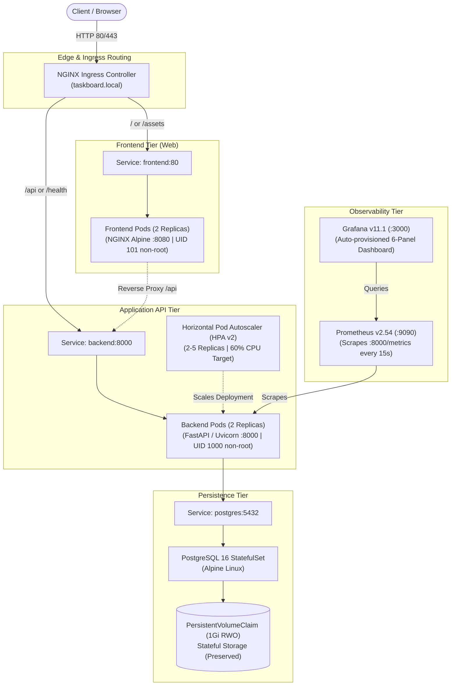
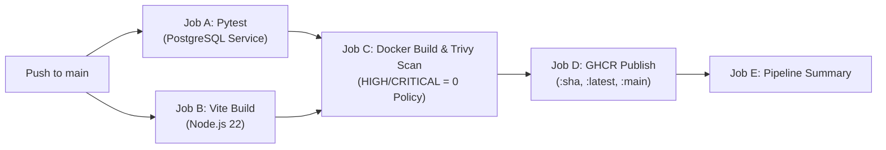

# TaskBoard — Cloud & DevOps Capstone Project

TaskBoard is a production-grade, SaaS-style project management platform engineered as an end-to-end DevOps capstone. Over the project lifecycle, TaskBoard has been architected, containerized, secured, orchestrated, monitored, and automated using modern industry-standard practices.

---

## 📋 Table of Contents
1. [Architecture & System Overview](#-architecture--system-overview)
2. [Technology Stack](#-technology-stack)
3. [Prerequisites & Environment](#-prerequisites--environment)
4. [Quick Start: Docker Compose](#-quick-start-docker-compose)
5. [Automated Testing & Quality Gates](#-automated-testing--quality-gates)
6. [Container Hardening & Non-Root Security](#-container-hardening--non-root-security)
7. [CI/CD & DevSecOps Pipeline](#-cicd--devsecops-pipeline)
8. [Kubernetes & Helm Deployment (Minikube)](#-kubernetes--helm-deployment-minikube)
9. [Observability: Prometheus & Grafana](#-observability-prometheus--grafana)
10. [Infrastructure as Code: Terraform AWS EKS](#-infrastructure-as-code-terraform-aws-eks)
11. [GitOps Continuous Delivery (ArgoCD)](#-gitops-continuous-delivery-argocd)
12. [API Reference & Health Endpoints](#-api-reference--health-endpoints)
13. [Troubleshooting & Safe Operations](#-troubleshooting--safe-operations)
14. [Submission Deliverables & Audit Summary](#-submission-deliverables--audit-summary)

---

## 🏗 Architecture & System Overview

TaskBoard implements a decoupled, resilient, multi-tier microservices architecture:



---

## 🛠 Technology Stack

| Component | Technologies & Versions |
| :--- | :--- |
| **Frontend Web** | React 18, Vite 8, Lucide Icons, NGINX Alpine (Port 8080, UID 101 non-root) |
| **Backend API** | Python 3.13 Slim, FastAPI, Uvicorn, Pydantic v2, Prometheus Instrumentator |
| **Database** | PostgreSQL 16 Alpine, SQLAlchemy 2.0, Alembic (Advisory Locking), psycopg 3 |
| **Containers** | Docker, Docker Compose, Multi-stage Dockerfiles, Bridge Networks |
| **Orchestration** | Kubernetes v1.37 (Minikube), Helm v3/v4, StatefulSets, Deployments, Services, HPA v2, Ingress |
| **Observability** | Prometheus 2.54, Grafana 11.1, PromQL, Automated Dashboard Provisioning |
| **Security & DevSecOps** | Aqua Security Trivy, Non-root runtime users, Pinned Action SHAs, GHCR |
| **CI/CD** | GitHub Actions (5-stage automated pipeline) |
| **Cloud IaC** | Terraform v1.16, AWS Provider v5.0, Amazon EKS (v1.35), VPC, IAM IRSA |
| **GitOps** | ArgoCD v2.12 application manifest with persistent storage protections |

---

## 💻 Prerequisites & Environment

- **OS:** Windows 11 (PowerShell) / Linux / macOS
- **Container Engine:** Docker Desktop (WSL2 engine) with Docker Compose
- **Cluster Tooling:** Minikube (`v1.39+`), `kubectl` (`v1.32+`), `helm` (`v3.14+`)
- **Languages & Runtimes:** Python `3.13+`, Node.js `22+`, npm `10+`
- **Infrastructure as Code:** Terraform `v1.16+`

---

## 🚀 Quick Start: Docker Compose

The complete 3-tier application runs locally with persistent storage:

```powershell
# 1. Copy sample environment file
cp .env.example .env

# 2. Build and launch all services in background
docker compose up -d --build

# 3. Verify health status of all containers
docker ps --format "table {{.Names}}\t{{.Status}}\t{{.Ports}}"
```

### Access URLs:
- **Frontend SPA:** [http://localhost:3000](http://localhost:3000)
- **Frontend NGINX Health:** [http://localhost:3000/nginx-health](http://localhost:3000/nginx-health)
- **Backend API Docs (Swagger):** [http://localhost:8000/docs](http://localhost:8000/docs)
- **Backend Health Probe:** [http://localhost:8000/health](http://localhost:8000/health)
- **Backend Database Ready:** [http://localhost:8000/ready](http://localhost:8000/ready)
- **Prometheus Metrics:** [http://localhost:8000/metrics](http://localhost:8000/metrics)
- **PostgreSQL Database:** `localhost:5433` (User: `taskboard`, Database: `taskboard`)

---

## 🧪 Automated Testing & Quality Gates

### Backend Test Suite (Pytest)
The backend test suite includes 16 comprehensive unit and integration tests executing against an **isolated in-memory SQLite database** (`sqlite:///:memory:`). This architectural separation guarantees that running tests **never** mutates or deletes live PostgreSQL development tasks (IDs 93 and 94).

```powershell
# Run backend test suite
& "backend\.venv\Scripts\python.exe" -m pytest backend/tests -v
```
*Result: 16 passed in ~0.26s.*

### Frontend Production Build
```powershell
cd frontend
npm ci
npm run build
cd ..
```
*Result: 1,908 modules transformed, built in ~1.36s with zero errors.*

---

## 🔒 Container Hardening & Non-Root Security

Both container images implement the **principle of least privilege**:

### Backend (`taskboard-backend:non-root`)
- Base image: `python:3.13-slim-bookworm`
- Non-root user: `appuser` (`UID 1000`, `GID 1000`)
- OS packages upgraded during build; apt caches cleaned.
- Clock-skew resilience configured: `-o Acquire::Check-Valid-Until=false -o Acquire::Max-FutureTime=86400`.

### Frontend (`taskboard-frontend:non-root`)
- Base image: `nginx:alpine`
- Non-root user: `nginx` (`UID 101`, `GID 101`)
- Unprivileged port: **8080**
- PID file relocated to unprivileged path: `/tmp/nginx.pid`
- Directory ownership configured for `/var/cache/nginx`, `/var/log/nginx`, `/usr/share/nginx/html`, and `/etc/nginx/conf.d`.

### Verification Command:
```powershell
docker run --rm --entrypoint id taskboard-backend:non-root
docker run --rm taskboard-frontend:non-root id
```
*Output: `uid=1000(appuser)` and `uid=101(nginx)`.*

---

## 🔄 CI/CD & DevSecOps Pipeline

The automated GitHub Actions workflow is defined in [`.github/workflows/ci-cd.yml`](file:///c:/Users/Shivansh/Desktop/devops_project/.github/workflows/ci-cd.yml):



### Trivy Vulnerability Policy
- Scans OS and library dependencies.
- Enforces an automated build failure (`exit-code: 1`) on any fixable `HIGH` or `CRITICAL` vulnerability.
- Local verification command:
  ```powershell
  docker run --rm -v /var/run/docker.sock:/var/run/docker.sock aquasec/trivy:latest image --severity HIGH,CRITICAL taskboard-frontend:non-root
  docker run --rm -v /var/run/docker.sock:/var/run/docker.sock aquasec/trivy:latest image --severity HIGH,CRITICAL --ignore-unfixed taskboard-backend:non-root
  ```
  *Result: 0 fixable vulnerabilities detected across both images.*

---

## ☸️ Kubernetes & Helm Deployment (Minikube)

### 1. Launch Minikube Cluster
```powershell
minikube start
minikube addons enable ingress
minikube addons enable metrics-server
```

### 2. Deploy via Helm Chart
```powershell
# Deploy with 2 backend replicas, 2 frontend replicas, HPA, and Ingress enabled
helm upgrade --install taskboard ./helm/taskboard `
  --namespace taskboard `
  --create-namespace `
  --set backend.autoscaling.enabled=true `
  --set backend.autoscaling.minReplicas=2 `
  --set frontend.replicaCount=2 `
  --set ingress.enabled=true `
  --set postgresql.auth.existingSecret=taskboard-secrets
```

### 3. Verify Workloads & High Availability
```powershell
kubectl get pods,deployments,services,ingress,hpa,pvc -n taskboard
```
*Observed:*
- `taskboard-backend`: 2/2 READY
- `taskboard-frontend`: 2/2 READY
- `taskboard-postgres-0`: 1/1 READY (Bound PVC: `taskboard-postgres-pvc`)
- `taskboard-backend-hpa`: 2 replicas active, targeting 60% CPU

### 4. Access via Ingress
Add `127.0.0.1 taskboard.local` to `C:\Windows\System32\drivers\etc\hosts`:
```powershell
# Forward Ingress port if using Docker desktop driver without minikube tunnel
kubectl port-forward -n ingress-nginx svc/ingress-nginx-controller 8085:80

# Query application via Ingress
curl.exe -i -H "Host: taskboard.local" http://127.0.0.1:8085/api/tasks
```

---

## 📊 Observability: Prometheus & Grafana

### Prometheus Monitoring
Prometheus is deployed in the `monitoring` namespace, configured with Kubernetes service discovery to harvest metrics from the FastAPI backend at `/metrics`.

```powershell
# Port-forward Prometheus Web UI
kubectl port-forward -n monitoring svc/prometheus 9090:9090
```
- Active scrape targets at [http://localhost:9090/targets](http://localhost:9090/targets):
  - `taskboard-backend` (UP)
  - `kubernetes-pods` (UP)
  - `prometheus` (UP)

### Grafana Dashboards
Grafana is pre-provisioned with the Prometheus datasource and the **TaskBoard Overview Dashboard**:

```powershell
# Port-forward Grafana Web UI
kubectl port-forward -n monitoring svc/grafana 3001:3000
```
- Open [http://localhost:3001](http://localhost:3001) (User: `admin`, Password: `admin`).
- Active PromQL Panels:
  1. **HTTP Request Volume** (`sum(rate(http_requests_total[1m])) by (handler, status)`)
  2. **HTTP Latency** (`histogram_quantile(0.95, ...)` & `0.99`)
  3. **HTTP 5xx Error Rate** (`sum(rate(http_requests_total{status=~"5.."}[1m]))`)
  4. **In-Flight Requests** (`sum(taskboard_inprogress_requests)`)
  5. **Backend Process CPU %** (`rate(process_cpu_seconds_total[1m]) * 100`)
  6. **Backend Resident Memory (MB)** (`process_resident_memory_bytes / 1048576`)

---

## ☁️ Infrastructure as Code: Terraform AWS EKS

The repository includes a modular Terraform architecture in [`terraform/`](file:///c:/Users/Shivansh/Desktop/devops_project/terraform) targeting AWS:

> [!IMPORTANT]
> **Cloud Provisioning Disclaimer:** In strict compliance with user instructions and the ₹0 budget constraint, AWS resources were **not provisioned**. The code is fully formatted and validated (`terraform validate` -> `Success! The configuration is valid.`). See [`docs/AWS_DEPLOYMENT_PREREQUISITES.md`](file:///c:/Users/Shivansh/Desktop/devops_project/docs/AWS_DEPLOYMENT_PREREQUISITES.md) for full deployment instructions, IAM policies, and cost breakdown.

### Architecture Highlights:
- **VPC & Subnets:** Multi-AZ VPC (`10.0.0.0/16`) across `us-east-1a` and `us-east-1b` with public and private subnets.
- **Amazon EKS:** Version 1.35 with private endpoint enabled by default and CIDR-restricted public access.
- **Node Groups:** 2x `t3.medium` managed worker nodes in private subnets with IMDSv2 enforced.
- **IAM IRSA:** Dedicated OIDC role for AWS EBS CSI driver (`AmazonEBSCSIDriverPolicy`).
- **AWS Helm Values:** Custom values configured in [`helm/taskboard/values-aws.yaml`](file:///c:/Users/Shivansh/Desktop/devops_project/helm/taskboard/values-aws.yaml).

---

## 🔄 GitOps Continuous Delivery (ArgoCD)

The repository provides declarative GitOps configuration in [`k8s/argocd/`](file:///c:/Users/Shivansh/Desktop/devops_project/k8s/argocd):
- [`k8s/argocd/application.yaml`](file:///c:/Users/Shivansh/Desktop/devops_project/k8s/argocd/application.yaml): ArgoCD `Application` resource targeting `helm/taskboard`.
- **Stateful Safety:** Configured with `prune: false` to ensure persistent storage and PVCs are **never** accidentally purged during automated Git reconciliations.
- **Automated Self-Healing:** Configured with `selfHeal: true` to automatically correct out-of-band cluster drift.
- Full setup instructions: [`k8s/argocd/README.md`](file:///c:/Users/Shivansh/Desktop/devops_project/k8s/argocd/README.md).

---

## 📡 API Reference & Health Endpoints

### System & Health Endpoints
| Method | Path | Description | Response Status |
| :--- | :--- | :--- | :---: |
| `GET` | `/` | Application metadata and OpenAPI links | 200 OK |
| `GET` | `/health` | Lightweight liveness probe | 200 OK |
| `GET` | `/ready` | Database readiness probe | 200 OK / 503 Unavailable |
| `GET` | `/metrics` | Prometheus metrics exposition | 200 OK |
| `GET` | `/nginx-health`| NGINX web server health check | 200 OK (`healthy`) |

### Task Management API (`/api/tasks`)
| Method | Endpoint | Description | Sample Status |
| :--- | :--- | :--- | :---: |
| `GET` | `/api/tasks` | List tasks (supports pagination `?skip=0&limit=10`) | 200 OK |
| `POST` | `/api/tasks` | Create task (`title`, `description`, `priority`, etc.) | 201 Created |
| `GET` | `/api/tasks/{id}` | Retrieve specific task | 200 OK / 404 Not Found |
| `PUT` | `/api/tasks/{id}` | Update task details or status | 200 OK / 404 Not Found |
| `DELETE`| `/api/tasks/{id}` | Delete task | 204 No Content |

#### Sample Task Creation:
```bash
curl -X POST http://localhost:3000/api/tasks \
  -H "Content-Type: application/json" \
  -d '{"title": "Verify Day 6 Capstone", "status": "todo", "priority": "high", "assignee": "Shivansh"}'
```

---

## 🛠 Troubleshooting & Safe Operations

> [!CAUTION]
> **Data Safety Directive:**
> Never run `docker compose down -v` or delete Kubernetes PersistentVolumeClaims (`kubectl delete pvc`). Doing so will permanently destroy active task records and PostgreSQL state!

| Symptom | Probable Cause | Action |
| :--- | :--- | :--- |
| `Nginx returns 502 Bad Gateway` | Backend container or pod is restarting. | Inspect backend logs: `docker compose logs backend` or `kubectl logs -n taskboard deployment/taskboard-backend`. |
| `Port 3000 or 5433 already in use` | Existing local processes bound to port. | Stop competing processes or adjust host port mapping in `docker-compose.yml`. |
| `Ingress returns 404 Not Found` | Host header mismatch. | Ensure request includes `Host: taskboard.local`. |
| `Database migration lock timeout` | Stale migration lock. | PostgreSQL uses transactional advisory lock (`72142718`). Lock releases automatically when transaction terminates. |

---

## 📦 Submission Deliverables & Audit Summary

The repository contains all required submission artifacts:
- [`docs/FINAL_AUDIT.md`](file:///c:/Users/Shivansh/Desktop/devops_project/docs/FINAL_AUDIT.md): Comprehensive module-by-module audit against official rubric.
- [`docs/FINAL_VALIDATION_REPORT.md`](file:///c:/Users/Shivansh/Desktop/devops_project/docs/FINAL_VALIDATION_REPORT.md): Exact command execution logs, test outputs, and evidence.
- [`docs/ARCHITECTURE.md`](file:///c:/Users/Shivansh/Desktop/devops_project/docs/ARCHITECTURE.md): Multi-tier architecture, network topology, CI/CD, and IaC Mermaid diagrams.
- [`docs/DEMO_SCRIPT.md`](file:///c:/Users/Shivansh/Desktop/devops_project/docs/DEMO_SCRIPT.md): Practical 10–12 minute video walkthrough narration and demonstration plan.
- [`docs/AWS_DEPLOYMENT_PREREQUISITES.md`](file:///c:/Users/Shivansh/Desktop/devops_project/docs/AWS_DEPLOYMENT_PREREQUISITES.md): Cloud prerequisites, IAM permissions, runbook, and cost breakdown.
- [`k8s/argocd/`](file:///c:/Users/Shivansh/Desktop/devops_project/k8s/argocd): Declarative ArgoCD Application manifest and GitOps operational guide.
- [`presentation/taskboard_capstone_presentation.pptx`](file:///c:/Users/Shivansh/Desktop/devops_project/presentation/taskboard_capstone_presentation.pptx): Professional 12-slide presentation deck.
- [`presentation/SLIDES.md`](file:///c:/Users/Shivansh/Desktop/devops_project/presentation/SLIDES.md): Slide-by-slide markdown transcript.
