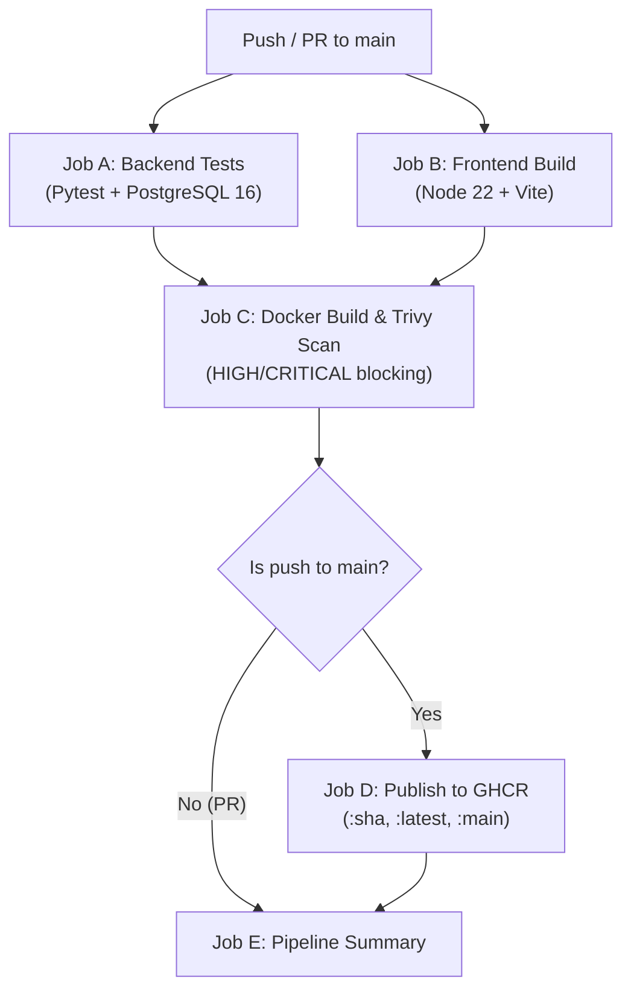
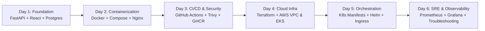

# TaskBoard — Cloud & DevOps Capstone Project

TaskBoard is a realistic, SaaS-style project management application engineered as a comprehensive 6-day DevOps capstone. Over the course of the project, TaskBoard transitions from local development to a fully automated cloud architecture on AWS EKS with Kubernetes, Helm, Terraform, Prometheus/Grafana observability, and GitHub Actions CI/CD.

---

## 🚀 Status Checkpoints

- **Day 1: Application Foundation (Completed)**: Core FastAPI backend, PostgreSQL database, Alembic migrations, Pytest suite, and React + Vite frontend.
- **Day 2: Complete Dockerization (Completed)**: Full multi-container architecture using Docker Compose. Frontend (Nginx reverse proxy + React SPA), Backend (FastAPI non-root container with auto-migrations), and PostgreSQL (persistent Alpine container) connected via a dedicated bridge network.
- **Day 3: CI/CD, Trivy Security & GHCR (Completed)**: Automated GitHub Actions pipeline (`.github/workflows/ci-cd.yml`) with PostgreSQL service container testing, Vite production build, Trivy container vulnerability scanning (HIGH/CRITICAL blocking policy), and automated image publishing to GitHub Container Registry (GHCR). Detailed guide: [docs/DAY3-CICD.md](file:///c:/Users/Shivansh/Desktop/devops_project/docs/DAY3-CICD.md).
- **Day 4: Kubernetes, Helm & Local Deployment (Completed)**: Full Kubernetes orchestration with 11 native manifests in `k8s/` and a modular Helm chart in `helm/taskboard/`. Features PostgreSQL StatefulSet with persistent storage, backend deployment with startup ordering initContainer, non-root security contexts, frontend Nginx proxy integration, and zero-error Helm linting/templating. Detailed guide: [docs/DAY4-KUBERNETES-HELM.md](file:///c:/Users/Shivansh/Desktop/devops_project/docs/DAY4-KUBERNETES-HELM.md).
- **Day 5: Ingress, Autoscaling & Monitoring (Completed)**: Multi-path Kubernetes Ingress (`taskboard.local`), Horizontal Pod Autoscaler (`autoscaling/v2`) targeting CPU utilization, PostgreSQL migration concurrency protection with transactional advisory locks, and modular Prometheus & Grafana observability stack with automated dashboard provisioning. Detailed guide: [docs/DAY5-INGRESS-HPA-MONITORING.md](file:///c:/Users/Shivansh/Desktop/devops_project/docs/DAY5-INGRESS-HPA-MONITORING.md).
- **Day 6, Stage 1: Terraform & AWS EKS (Completed)**: Modular, production-grade Infrastructure as Code for AWS. Provisions a dedicated multi-AZ VPC, public/private subnets, cost-optimized NAT Gateway, security group boundaries, IAM roles with OIDC provider (IRSA), Amazon EKS cluster (v1.35), managed worker node group, and production Helm values for AWS. Detailed guide: [docs/DAY6-TERRAFORM-EKS.md](file:///c:/Users/Shivansh/Desktop/devops_project/docs/DAY6-TERRAFORM-EKS.md).

---

## 🛠 Technology Stack

| Layer | Technologies |
| :--- | :--- |
| **Frontend** | React 18, Vite 8, Lucide Icons, Nginx 1.27 Alpine (Reverse Proxy & SPA routing) |
| **Backend** | Python 3.13 Slim, FastAPI, Uvicorn, Pydantic v2, Prometheus Instrumentator |
| **Database** | PostgreSQL 16 Alpine, SQLAlchemy 2.0, Alembic, psycopg 3 |
| **Containerization** | Docker, Docker Compose, Multi-stage Dockerfiles, Bridge Networks |
| **Orchestration** | Kubernetes (StatefulSets, Deployments, Services, ConfigMaps, Secrets, Ingress, HPA v2), Helm v3/v4 |
| **Observability** | Prometheus 2.54, Grafana 11.1, PromQL, Automated Dashboard Provisioning |
| **Testing** | Pytest, FastAPI TestClient, HTTPX |
| **CI/CD & Security** | GitHub Actions, Aqua Security Trivy, GitHub Container Registry (GHCR) |
| **Cloud & Infra** | Terraform >= 1.5, AWS Provider 5.0, Amazon EKS (v1.35), AWS VPC, NAT Gateway, IAM IRSA |

---

## 📁 Repository Structure

```
devops_project/
├── frontend/                     # React + Vite frontend application
│   ├── src/                      # UI components, API services, and styles
│   ├── nginx.conf                # Nginx reverse proxy & SPA fallback configuration
│   ├── Dockerfile                # Multi-stage build (Node 22 builder -> Nginx runtime)
│   ├── .dockerignore             # Excludes node_modules, dist, and local artifacts
│   ├── package.json
│   └── vite.config.js            # Vite proxy configuration for local dev
├── backend/                      # FastAPI Python backend application
│   ├── app/                      # Route controllers, schemas, models, and services
│   ├── alembic/                  # Database migration scripts
│   ├── tests/                    # Automated pytest test suite
│   ├── entrypoint.sh             # Startup script: applies Alembic migrations, then execs uvicorn
│   ├── Dockerfile                # Production Dockerfile (python:3.13-slim, non-root user)
│   ├── .dockerignore             # Excludes .venv, caches, tests, and env files
│   ├── alembic.ini               # Alembic configuration
│   └── requirements.txt          # Python dependencies
├── terraform/                    # (Day 6) Modular AWS VPC & EKS Infrastructure as Code
├── helm/taskboard/               # (Day 4/5/6) Helm charts for Kubernetes (Minikube & AWS EKS)
├── k8s/                          # (Day 4/5) Kubernetes manifests (including HPA and monitoring/)
│   └── monitoring/               # (Day 5) Prometheus & Grafana native manifests
├── monitoring/                   # (Day 5) Standalone Grafana dashboards & Prometheus config
├── troubleshooting/              # (Day 6) Debugging runbooks and incident scenarios
├── scripts/                      # Automation & setup scripts
├── .github/workflows/            # (Day 3) GitHub Actions CI/CD pipelines
├── docker-compose.yml            # Multi-container Compose stack (frontend, backend, postgres)
├── .env.example                  # Environment configuration template
├── .gitignore                    # Git ignore rules for Python, Node, Docker, & secrets
├── README.md                     # Project documentation & operational guides
└── PROJECT_REQUIREMENTS.md       # 6-day project requirements & acceptance tracker
```

---

## 📋 Prerequisites

- **Windows 11** with PowerShell
- **Docker Desktop** (`docker --version` >= 27) with WSL2 backend
- **Git** (`git --version` >= 2.40)
- Optional for host development: **Python** >= 3.11, **Node.js** >= 20

---

## 🐳 Running with Docker Compose (Recommended)

### 1. Configure Environment

Copy the example configuration to `.env`:

```powershell
Copy-Item .env.example .env
```

> **Security Note**: Development credentials (`taskboard:taskboard`) are set for local evaluation only. Never commit `.env` or use default credentials in production environments.

### 2. Build and Start the Complete Stack

Execute a single command to build the container images and launch the services:

```powershell
docker compose up --build -d
```

Compose automatically coordinates service startup:
1. Starts **PostgreSQL 16** and runs health checks using `pg_isready`.
2. Starts **FastAPI Backend** once PostgreSQL is healthy, automatically applies Alembic migrations, and starts Uvicorn.
3. Starts **Nginx Frontend** once the backend is healthy, serving the React SPA and proxying API traffic.

### 3. Verify Container Status & Health

```powershell
docker compose ps
```

All three services should report `Up` and `(healthy)`:

```
NAME                 IMAGE                      STATUS
taskboard-postgres   postgres:16-alpine         Up (healthy)
taskboard-backend    devops_project-backend     Up (healthy)
taskboard-frontend   devops_project-frontend    Up (healthy)
```

---

## 🌐 Application Access & Endpoints

| Service / Endpoint | URL | Description |
| :--- | :--- | :--- |
| **Frontend Dashboard** | `http://localhost:3000` | TaskBoard SaaS project management UI |
| **Backend Liveness Probe** | `http://localhost:3000/health` | Lightweight process check (via Nginx proxy) |
| **Database Readiness Probe** | `http://localhost:3000/ready` | Live PostgreSQL connectivity check (via Nginx proxy) |
| **Interactive API Docs** | `http://localhost:3000/docs` | OpenAPI Swagger UI (via Nginx proxy) |
| **Prometheus Metrics** | `http://localhost:3000/metrics` | Application metrics exposition (via Nginx proxy) |
| **Task REST API** | `http://localhost:3000/api/tasks` | Task CRUD endpoints (via Nginx proxy) |
| **Task Statistics** | `http://localhost:3000/api/tasks/stats` | KPI aggregate statistics (via Nginx proxy) |
| **Direct Backend (Dev)** | `http://localhost:8000` | Optional direct backend access on host |

---

## 🔎 Inspecting Logs and Managing the Stack

### View Container Logs
```powershell
# Follow logs for all containers
docker compose logs -f

# View logs for a specific service
docker compose logs backend
docker compose logs frontend
docker compose logs postgres
```

### Stop the Stack Safely
```powershell
# Stop running containers while preserving all database data
docker compose down
```

> ⚠️ **Warning**: Never run `docker compose down -v` unless you explicitly want to erase your PostgreSQL database volume and all saved tasks.

### Restart Services (Data Persistence)
```powershell
docker compose restart
```

---

## ☸️ Running with Kubernetes & Helm

TaskBoard supports deployment onto local Kubernetes clusters (Minikube or Docker Desktop Kubernetes) using raw manifests (`k8s/`) or the Helm chart (`helm/taskboard`).

Detailed architecture, security practices, and troubleshooting runbooks are available in [docs/DAY4-KUBERNETES-HELM.md](file:///c:/Users/Shivansh/Desktop/devops_project/docs/DAY4-KUBERNETES-HELM.md).

### 1. Deploying via Helm (Recommended)

```powershell
# 1. Create dedicated namespace and dynamically generate the Secret (URL-safe)
kubectl create namespace taskboard

$chars = 'abcdefghijklmnopqrstuvwxyzABCDEFGHIJKLMNOPQRSTUVWXYZ0123456789'
$bytes = New-Object byte[] 24
[System.Security.Cryptography.RandomNumberGenerator]::Create().GetBytes($bytes)
$dbPassword = (-join ($bytes | ForEach-Object { $chars[$_ % $chars.Length] }))
$databaseUrl = "postgresql+psycopg://taskboard:$([System.Uri]::EscapeDataString($dbPassword))@postgres:5432/taskboard"

kubectl create secret generic taskboard-secrets -n taskboard `
  --from-literal=POSTGRES_PASSWORD="$dbPassword" `
  --from-literal=DATABASE_URL="$databaseUrl"

# Verify Secret exists without exposing credentials
kubectl get secret taskboard-secrets -n taskboard

# 2. Deploy or upgrade the Helm release referencing the Secret
helm upgrade --install taskboard helm/taskboard `
  --namespace taskboard `
  --set postgresql.auth.existingSecret=taskboard-secrets

# 3. Check Pod rollout status
kubectl get pods -n taskboard -w

# 4. Access the application via port-forward
kubectl port-forward svc/frontend 3000:80 -n taskboard
```

### 2. Deploying via Raw Kubernetes Manifests

```powershell
# 1. Create namespace
kubectl apply -f k8s/00-namespace.yaml

# 2. Create the Secret dynamically (k8s/02-secret.yaml is a template; do NOT apply it directly)
$chars = 'abcdefghijklmnopqrstuvwxyzABCDEFGHIJKLMNOPQRSTUVWXYZ0123456789'
$bytes = New-Object byte[] 24
[System.Security.Cryptography.RandomNumberGenerator]::Create().GetBytes($bytes)
$dbPassword = (-join ($bytes | ForEach-Object { $chars[$_ % $chars.Length] }))
$databaseUrl = "postgresql+psycopg://taskboard:$([System.Uri]::EscapeDataString($dbPassword))@postgres:5432/taskboard"

kubectl create secret generic taskboard-secrets -n taskboard `
  --from-literal=POSTGRES_PASSWORD="$dbPassword" `
  --from-literal=DATABASE_URL="$databaseUrl"

# 3. Apply configurations, persistent volume, and workloads
kubectl apply -f k8s/01-configmap.yaml
kubectl apply -f k8s/03-postgres-pvc.yaml
kubectl apply -f k8s/04-postgres-statefulset.yaml
kubectl apply -f k8s/05-postgres-service.yaml
kubectl apply -f k8s/06-backend-deployment.yaml
kubectl apply -f k8s/07-backend-service.yaml
kubectl apply -f k8s/08-frontend-deployment.yaml
kubectl apply -f k8s/09-frontend-service.yaml
```

---

## 🧪 Automated Testing (Host Development)

You can run the existing automated test suite against the running database container on host port `5433`:

```powershell
# Run the 16 automated backend tests
& "backend\.venv\Scripts\pytest.exe" -v backend\tests

# Run frontend build check
cd frontend
npm run build
```

---

## 🔧 Architecture & Troubleshooting Guide

### Docker Networking Architecture
- All three containers communicate within an isolated Docker bridge network: `taskboard_network`.
- The frontend Nginx container communicates with the backend via internal service DNS: `http://backend:8000`.
- The backend communicates with PostgreSQL via internal service DNS: `postgres:5432`.
- PostgreSQL is only published to host port `5433` for optional local host tooling, avoiding collisions with any local PostgreSQL instance on port `5432`.

### Common Issues & Resolutions

| Issue | Root Cause | Resolution |
| :--- | :--- | :--- |
| `Port 5433 already in use` | Another container or process is using port 5433. | Change `POSTGRES_PORT` in `.env` to another port (e.g. `5434`). |
| `Backend fails with connection refused` | Database container not yet ready. | The `docker-compose.yml` uses `depends_on: { postgres: { condition: service_healthy } }` to ensure PostgreSQL is ready before backend boots. |
| `Migrations do not apply` | Database URL incorrect or schema out of sync. | Inspect logs with `docker compose logs backend`. The entrypoint script runs `alembic upgrade head` before Uvicorn starts. |
| `Frontend returns 502 Bad Gateway` | Backend container is restarting or unhealthy. | Check `docker compose logs backend` to resolve backend crashes. |

---

## 🔄 Automated CI/CD Pipeline (GitHub Actions)

TaskBoard includes a production-ready automated CI/CD pipeline defined in [.github/workflows/ci-cd.yml](file:///c:/Users/Shivansh/Desktop/devops_project/.github/workflows/ci-cd.yml):



- **Trigger**: Every push and pull request targeting `main`.
- **Database in CI**: Spawns an isolated `postgres:16-alpine` service container and executes Alembic migrations prior to running Pytest.
- **Trivy Vulnerability Scan**: Enforces a strict blocking policy on HIGH/CRITICAL CVEs for both backend and frontend images.
- **GHCR Publishing**: Only pushes to `main` publish images to `ghcr.io/<owner>/<repo>-backend` and `-frontend`.
- For full architecture details and manual GitHub configuration steps, see [docs/DAY3-CICD.md](file:///c:/Users/Shivansh/Desktop/devops_project/docs/DAY3-CICD.md).

---

## 🗺 DevOps Capstone 6-Day Roadmap


