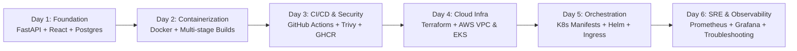

# TaskBoard — Cloud & DevOps Capstone Project

TaskBoard is a realistic, SaaS-style project management application engineered as a comprehensive 6-day DevOps capstone. Over the course of the project, TaskBoard transitions from local development to a fully automated cloud architecture on AWS EKS with Kubernetes, Helm, Terraform, Prometheus/Grafana observability, and GitHub Actions CI/CD.

---

## 🚀 Day 1 Status: Application Foundation (Completed)

- **Frontend**: Modern, responsive React + Vite dashboard with dark sidebar, KPI cards, task management table, status & priority filters, creation/edit modals, live activity feed, and Vite dev proxy.
- **Backend**: Modular FastAPI architecture with SQLAlchemy ORM, Pydantic schemas, business services, and Prometheus metrics instrumentation.
- **Database**: PostgreSQL 16 containerized with Docker Compose, with schema management powered by Alembic migrations.
- **Testing**: 16 automated tests covering API routes, database operations, health/readiness probes, and error handling.

---

## 🛠 Technology Stack

| Layer | Technologies |
| :--- | :--- |
| **Frontend** | React 18, Vite 8, Lucide Icons, Vanilla CSS (Dark Theme System) |
| **Backend** | Python 3.13, FastAPI, Uvicorn, Pydantic v2, Prometheus Instrumentator |
| **Database** | PostgreSQL 16, SQLAlchemy 2.0, Alembic, psycopg 3 |
| **Testing** | Pytest, FastAPI TestClient, HTTPX |
| **DevOps & Cloud** | Docker, Docker Compose, Git *(Future: Terraform, AWS EKS, Helm, K8s, GitHub Actions)* |

---

## 📁 Repository Structure

```
devops_project/
├── frontend/                     # React + Vite frontend application
│   ├── src/
│   │   ├── components/           # UI presentation components (Sidebar, Header, Table, Modal, etc.)
│   │   ├── services/             # API client services (relative proxy routes)
│   │   ├── App.jsx               # Application state orchestration
│   │   ├── main.jsx              # React DOM entry point
│   │   └── index.css             # Rich dark theme styling tokens & animations
│   ├── package.json
│   └── vite.config.js            # Vite proxy configuration for /api, /health, /ready, /metrics
├── backend/                      # FastAPI Python backend application
│   ├── app/
│   │   ├── api/endpoints/        # Route controllers (tasks, health, ready, metrics)
│   │   ├── core/                 # App configuration & settings (Pydantic Settings)
│   │   ├── db/                   # SQLAlchemy engine, session maker, and connectivity probes
│   │   ├── models/               # SQLAlchemy ORM models (Task)
│   │   ├── schemas/              # Pydantic validation schemas (TaskCreate, TaskResponse, Stats)
│   │   ├── services/             # Business logic layer (Task queries & aggregations)
│   │   └── main.py               # FastAPI application factory & CORS setup
│   ├── alembic/                  # Database migration scripts
│   │   ├── versions/             # Migration version files (001_initial_tasks_table.py)
│   │   └── env.py                # Alembic runtime environment
│   ├── tests/                    # Automated pytest test suite
│   │   ├── conftest.py           # Database isolation fixtures & TestClient setup
│   │   ├── test_health_and_system.py # Health, readiness, and metrics tests
│   │   └── test_tasks_api.py     # CRUD, validation, search, filter, and stats tests
│   ├── alembic.ini               # Alembic database configuration
│   └── requirements.txt          # Python dependencies
├── terraform/                    # (Day 4) AWS infrastructure as code
├── helm/taskboard/               # (Day 5) Helm charts for Kubernetes deployment
├── k8s/                          # (Day 5) Kubernetes manifests
├── monitoring/                   # (Day 6) Prometheus & Grafana alerting & dashboards
├── troubleshooting/              # (Day 6) Debugging runbooks and incident scenarios
├── scripts/                      # Automation & setup scripts
├── .github/workflows/            # (Day 3) GitHub Actions CI/CD pipelines
├── docker-compose.yml            # Local development multi-container orchestration
├── .env.example                  # Environment configuration template
├── .gitignore                    # Git ignore rules for Python, Node, Docker, & secrets
├── README.md                     # Project documentation
└── PROJECT_REQUIREMENTS.md       # 6-day project requirements & acceptance tracker
```

---

## 📋 Prerequisites

- **Windows 11** with PowerShell
- **Git** (`git --version` >= 2.40)
- **Python** (`python --version` >= 3.11)
- **Node.js & npm** (`node --version` >= 20, `npm --version` >= 10)
- **Docker Desktop** (`docker --version` >= 27)

---

## ⚡ Quick Start (Windows PowerShell)

### 1. Database Setup (Docker Compose)

Start the PostgreSQL 16 container in the background:

```powershell
# Copy environment template
Copy-Item .env.example .env

# Start PostgreSQL container on port 5433 (avoiding conflicts with existing local Postgres instances)
docker compose up -d postgres

# Verify container health
docker compose ps
```

### 2. Backend Setup & Migrations

```powershell
# Create Python virtual environment inside backend/
python -m venv backend\.venv

# Activate virtual environment (or use direct path without changing policy)
# Option A: Direct execution (recommended for security)
& "backend\.venv\Scripts\python.exe" -m pip install -r backend\requirements.txt

# Run Alembic migrations to initialize the database schema
& "backend\.venv\Scripts\alembic.exe" -c backend\alembic.ini upgrade head

# Start the FastAPI server with live reload
& "backend\.venv\Scripts\python.exe" -m uvicorn backend.app.main:app --host 127.0.0.1 --port 8000 --reload
```

> **PowerShell ExecutionPolicy Note**: If you encounter `cannot be loaded because running scripts is disabled on this system` when running `Activate.ps1`, you can either execute Python directly using `& "backend\.venv\Scripts\python.exe"` or run `Set-ExecutionPolicy -Scope Process -ExecutionPolicy Bypass` in your active session.

### 3. Frontend Setup

In a second PowerShell window:

```powershell
# Navigate to frontend and install dependencies
cd frontend
npm install

# Start the Vite development server
npm run dev
```

Visit **`http://localhost:5173`** in your browser to explore the TaskBoard dashboard!

---

## 🧪 Automated Testing

Execute the complete automated test suite using `pytest`:

```powershell
& "backend\.venv\Scripts\pytest.exe" -v backend\tests
```

All 16 tests validate:
- System Root metadata (`GET /`)
- Lightweight Liveness probe (`GET /health`)
- Database Readiness probe (`GET /ready`) with healthy and simulated failure modes
- Prometheus metrics output (`GET /metrics`)
- Task creation with validation and error rejection (`POST /api/tasks`)
- Task retrieval, 404 responses for nonexistent IDs (`GET /api/tasks/{id}`)
- Task search, status filtering, and priority filtering (`GET /api/tasks`)
- Task updates and deletion (`PUT /api/tasks/{id}`, `DELETE /api/tasks/{id}`)
- Statistical aggregation for dashboard KPIs (`GET /api/tasks/stats`)

---

## 🌐 API Endpoint Reference

The backend exposes an interactive OpenAPI Swagger UI at **`http://localhost:8000/docs`**.

| Method | Endpoint | Description | Status Codes |
| :--- | :--- | :--- | :--- |
| `GET` | `/` | Application metadata and docs pointers | 200 |
| `GET` | `/health` | Liveness check (independent of database) | 200 |
| `GET` | `/ready` | Readiness check (verifies live DB connection) | 200, 503 |
| `GET` | `/metrics` | Prometheus metrics scrape endpoint | 200 |
| `GET` | `/api/tasks` | List tasks (supports `search`, `status`, `priority`) | 200 |
| `GET` | `/api/tasks/stats` | KPI statistics (total, todo, in-progress, done, priorities) | 200 |
| `GET` | `/api/tasks/{id}` | Retrieve single task by integer ID | 200, 404 |
| `POST` | `/api/tasks` | Create a new task (validates required title) | 201, 422 |
| `PUT` | `/api/tasks/{id}` | Update existing task | 200, 404, 422 |
| `DELETE` | `/api/tasks/{id}`| Delete existing task | 200, 404 |

---

## 🔍 Observability: Liveness vs Readiness

- **/health (Liveness Probe)**: Fast, lightweight check verifying that the Uvicorn web server process is responsive. It does not query the database. In Kubernetes, if this fails, the container is restarted.
- **/ready (Readiness Probe)**: Verifies that backend dependencies (specifically the PostgreSQL connection pool) can execute queries. If the database is unreachable, it returns HTTP 503. In Kubernetes, if this fails, traffic is diverted away from the pod without restarting it.
- **/metrics (Prometheus Endpoint)**: Exposes standard application metrics such as request durations, status code distributions, and concurrent requests.

---

## 🛠 Frontend Production Build

Validate the production bundle for correctness:

```powershell
cd frontend
npm run build
```

Build output is written to `frontend/dist/` ready to be served by Nginx or containerized in Day 2.

---

## 🗺 DevOps Capstone 6-Day Roadmap



---

## 🔧 Troubleshooting Guide

| Issue | Cause | Solution |
| :--- | :--- | :--- |
| `Port 5432 is already in use` | Local Windows PostgreSQL service is running on port 5432. | The project uses port `5433` by default via Docker Compose. Ensure `DATABASE_URL` in `.env` specifies port `5433`. |
| `alembic: command not found` | Virtual environment is not activated or not using full path. | Run using `& "backend\.venv\Scripts\alembic.exe" -c backend\alembic.ini upgrade head`. |
| `Cannot connect to Docker daemon` | Docker Desktop is stopped. | Launch Docker Desktop from the Windows Start menu and wait for the whale icon to stabilize. |
| `CORS Error in browser` | Frontend is calling backend directly instead of using Vite proxy. | Use relative paths (`/api/tasks`) in frontend code. Vite forwards them automatically. |
