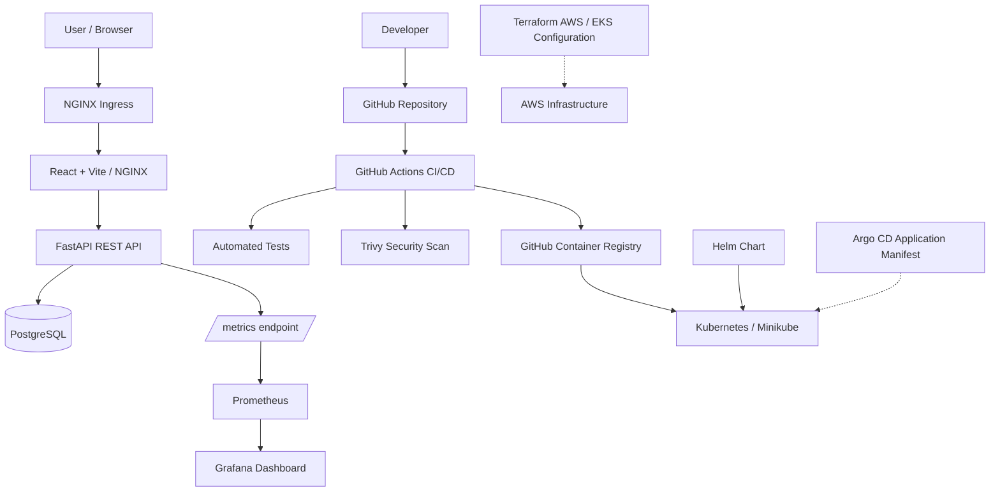

# TaskBoard — Cloud DevOps Capstone

A containerized task management application demonstrating modern DevOps practices, including CI/CD automation, container security, Kubernetes orchestration, infrastructure as code, and application observability.

## 1. Project Description and Purpose

TaskBoard is a full-stack task management application built to demonstrate an end-to-end DevOps workflow.

The project combines a React frontend, FastAPI backend, and PostgreSQL database with automated testing, Docker containerization, GitHub Actions, Trivy security scanning, Kubernetes, Helm, Terraform, Prometheus, and Grafana.

### Objectives

- Build and test a full-stack application.
- Containerize services using Docker and Docker Compose.
- Automate testing, builds, security scanning, and image publishing.
- Deploy the application to Kubernetes using declarative configurations.
- Define AWS infrastructure using Terraform.
- Monitor application performance using Prometheus and Grafana.
- Apply container security and persistent storage best practices.

## 2. Architecture Overview



### Component Overview

| Component | Responsibility |
|---|---|
| React + Vite | Frontend user interface |
| NGINX | Frontend static-file serving and API reverse proxy |
| FastAPI | Backend REST API and application logic |
| PostgreSQL | Persistent relational data storage |
| SQLAlchemy | Database access and ORM |
| Alembic | Database schema migrations |
| Docker Compose | Local multi-container development |
| GitHub Actions | CI/CD automation |
| GHCR | Container image registry |
| Trivy | Container vulnerability scanning |
| Kubernetes | Workload orchestration and scaling |
| Helm | Kubernetes application packaging and deployment |
| Terraform | AWS infrastructure definitions |
| Prometheus | Metrics collection |
| Grafana | Metrics visualization |
| Argo CD | Declarative GitOps configuration |

The Terraform and Argo CD components describe the intended cloud infrastructure and GitOps workflow. Their presence in the repository does not imply that AWS resources have been provisioned or Argo CD has been deployed.

## 3. Technology Stack

### Languages and Frameworks
- Python
- JavaScript / TypeScript
- React
- Vite
- FastAPI
- SQLAlchemy
- SQL

### DevOps and Infrastructure
- Docker and Docker Compose
- Git and GitHub
- GitHub Actions
- GitHub Container Registry
- Trivy
- Kubernetes and Minikube
- Helm
- Terraform
- AWS VPC and EKS configuration
- Argo CD manifests

### Testing and Observability
- Pytest
- SQLite for isolated backend tests
- Prometheus
- Grafana
- NGINX

## 4. Repository Structure

The primary project components are organized as follows. Exact supporting filenames may vary with the latest repository changes.

```text
taskboard-devops-capstone/
├── backend/
│   ├── Dockerfile
│   ├── requirements.txt
│   └── ...
├── frontend/
│   ├── Dockerfile
│   ├── package.json
│   └── ...
├── terraform/
│   ├── vpc.tf
│   ├── eks.tf
│   ├── iam.tf
│   ├── security_groups.tf
│   ├── variables.tf
│   ├── outputs.tf
│   └── versions.tf
├── k8s/
│   ├── argocd/
│   └── ...
├── helm/
│   └── taskboard/
├── .github/
│   └── workflows/
├── docker-compose.yml
└── README.md
```

The repository also contains supporting documentation and presentation/demo materials.

## 5. Local Setup

### Prerequisites

Install the following tools:

- Git
- Docker Desktop or Docker Engine
- Docker Compose

### Clone the repository

```bash
git clone https://github.com/shivansh023023/taskboard-devops-capstone.git
cd taskboard-devops-capstone
```

### Start the application

Build the images and start the services:

```bash
docker compose up -d --build
```

Check container status:

```bash
docker compose ps
```

View logs:

```bash
docker compose logs -f
```

### Access the services

| Service | Local address |
|---|---|
| Frontend | http://localhost:3000 |
| Backend API | http://localhost:8000 |
| API documentation | http://localhost:8000/docs |
| Health check | http://localhost:8000/health |
| Readiness check | http://localhost:8000/ready |
| Prometheus metrics endpoint | http://localhost:8000/metrics |

The PostgreSQL service is mapped to host port `5433` in the Docker Compose configuration. The database container listens on its internal PostgreSQL port, `5432`.

Verify the frontend and backend endpoints after the containers become healthy.

### Stop the application

```bash
docker compose down
```

This stops and removes the Compose containers and network without explicitly deleting named volumes. Do not use `docker compose down -v` if you need to preserve database data.

## 6. Testing

The backend uses Pytest for automated API and application testing.

The test suite covers:

- Health and readiness endpoints
- Application metadata
- Task creation, retrieval, updating, and deletion
- Database-unavailable behavior

Tests use an isolated in-memory SQLite database to prevent test cleanup from modifying the live PostgreSQL database.

Run the tests in an environment where the project's test dependencies are installed:

```bash
cd backend
pytest -v
```

Validate the frontend production build:

```bash
cd frontend
npm ci
npm run build
```

The project has previously passed a 16-test backend suite and a frontend production build. Re-run both commands against the latest commit to verify the current state.

## 7. CI/CD Pipeline

The project uses GitHub Actions to automate validation and container delivery.

The workflow contains the following stages:

1. **Backend tests:** Starts PostgreSQL, applies Alembic migrations, and executes Pytest.
2. **Frontend build:** Installs dependencies and creates the production frontend bundle.
3. **Container build and security scan:** Builds the application images and scans them using Trivy.
4. **GHCR publishing:** Publishes images on pushes to the `main` branch, using the Git commit SHA and the `main` tag as configured.
5. **Pipeline summary:** Summarizes the workflow outcome.

Third-party GitHub Actions are pinned to commit SHAs to improve supply-chain security, and workflow permissions are restricted where possible.

### Trigger the pipeline

Make a legitimate change, then run:

```bash
git add -A
git commit -m "docs: update project documentation"
git push origin main
```

Open the repository's **Actions** tab to inspect the workflow run, individual jobs, logs, and final status.

The actual result should be verified in GitHub after the push.

## 8. Container Security with Trivy

Trivy scans container images for known vulnerabilities.

The configured pipeline uses a severity policy that fails the scan when fixable High or Critical vulnerabilities are detected.

The project also applies container hardening measures:

- Non-root backend runtime user
- Non-root NGINX runtime user
- Unprivileged frontend container port
- Multi-stage container builds where configured
- Restricted CI workflow permissions
- Immutable action references
- Isolated test database

Trivy results depend on the image version, vulnerability database, and scan options. Review the latest GitHub Actions logs for the authoritative scan results.

## 9. Kubernetes and Helm Deployment

The application includes Kubernetes resources and a Helm chart for deploying the frontend, backend, and PostgreSQL components.

### Start Minikube

```bash
minikube start
minikube status
kubectl get nodes
```

### Deploy using Helm

From the repository root, inspect the chart and its values:

```bash
helm lint ./helm/taskboard
helm template taskboard ./helm/taskboard
```

Install or upgrade the release using the chart's configured values:

```bash
helm upgrade --install taskboard ./helm/taskboard \
  --namespace taskboard \
  --create-namespace
```

**Important:** Review `helm/taskboard/values.yaml` and the chart templates first. If the existing deployment uses customized values or a different release name, supply those values and match the existing installation rather than creating conflicting resources.

### Verify the deployment

```bash
kubectl get pods -n taskboard
kubectl get deployments -n taskboard
kubectl get services -n taskboard
kubectl get ingress -n taskboard
helm list -n taskboard
helm status taskboard -n taskboard
```

Wait for deployments to become ready:

```bash
kubectl rollout status deployment/taskboard-frontend -n taskboard
kubectl rollout status deployment/taskboard-backend -n taskboard
```

The deployment names above should match the names in the current Helm chart. If they differ, use the names returned by `kubectl get deployments -n taskboard`.

The intended configuration includes two frontend replicas, two backend replicas, a PostgreSQL StatefulSet, and persistent storage. An optional Horizontal Pod Autoscaler is configured for backend scaling.

### Ingress

The configured Ingress hostname is:

```text
taskboard.local
```

Inspect its address and routing rules:

```bash
kubectl describe ingress taskboard-ingress -n taskboard
```

The hostname may require local DNS or a hosts-file entry and a working Minikube networking setup. Verify that the route is accessible before relying on it.

### Persistent storage

Inspect the database pod and storage claims:

```bash
kubectl get statefulsets,pods,pvc -n taskboard
```

Do not delete the PostgreSQL PersistentVolumeClaim or its underlying data when reinstalling the application.

## 10. Terraform Infrastructure

The `terraform/` directory contains infrastructure-as-code definitions for an AWS-based architecture.

The configuration covers:

- A Virtual Private Cloud
- Public and private subnets across multiple Availability Zones
- Routing and NAT configuration
- Security groups
- An Amazon EKS cluster and managed node group
- IAM roles and permissions
- OIDC-based IAM role configuration for the EBS CSI driver

### Validate the configuration

Run these commands from the Terraform directory:

```bash
cd terraform
terraform fmt -check -recursive
terraform validate
terraform plan
```

Terraform validation checks configuration structure and consistency. Planning additionally requires suitable provider credentials and access to the necessary AWS APIs.

### AWS deployment status

The Terraform configuration has passed formatting and validation checks. The last recorded `terraform plan` attempt failed because valid AWS credentials were unavailable.

**AWS VPC and EKS resources have not been provisioned as part of this zero-budget project validation.** Therefore, the repository should not be interpreted as evidence of a running AWS environment.

No `terraform apply` or `terraform destroy` is required for local validation. Before any future deployment, review the plan, IAM permissions, region, and estimated costs.

## 11. Observability: Prometheus and Grafana

The project includes Prometheus and Grafana in the local Kubernetes monitoring environment.

### Prometheus

The FastAPI backend exposes application metrics at:

```text
/metrics
```

For the local Docker Compose deployment:

```text
http://localhost:8000/metrics
```

For Kubernetes, use the configured Service and Prometheus scrape configuration.

Verify the monitoring resources:

```bash
kubectl get pods -n monitoring
kubectl get services -n monitoring
```

Open the Prometheus Targets page using the configured local access method and verify that the TaskBoard backend target reports `UP`.

### Grafana

Open Grafana using the service's configured access method. If using port-forwarding, first inspect the actual service name:

```bash
kubectl get services -n monitoring
```

Then forward the appropriate service and port, for example:

```bash
kubectl port-forward -n monitoring svc/grafana 3001:80
```

If the service uses a different port or name, adjust the command to match its definition.

Open:

```text
http://localhost:3001
```

Use the credentials configured for the local deployment; do not commit passwords or other secrets to Git.

The TaskBoard dashboard is designed to display:

- HTTP request volume
- Request latency, including p95 and p99
- HTTP 5xx error rate
- In-progress requests
- CPU utilization
- Resident memory usage

A successful metrics endpoint response does not by itself prove that Prometheus is scraping the application. Confirm the target status and that the dashboard is displaying current data.

## 12. GitOps with Argo CD

The repository contains an Argo CD Application manifest under:

```text
k8s/argocd/application.yaml
```

The manifest describes a GitOps workflow targeting the repository's Helm chart.

Its intended behavior includes:

- Declarative application configuration
- Automatic reconciliation of desired state
- Self-healing configuration
- Automatic pruning disabled to reduce the risk of unintended resource removal

The current local environment has not been verified with a running Argo CD installation. Consequently, the manifest represents the GitOps configuration, not proof of a live Synced and Healthy Argo CD application.

A live GitOps demonstration requires installing and configuring Argo CD, applying the Application manifest, and verifying its synchronization and health status.

## 13. Known Issues and Limitations

- **AWS provisioning:** Terraform configuration is implemented and validated, but AWS planning was blocked by missing credentials. No live EKS deployment is claimed.
- **Argo CD:** The Application manifest exists, but Argo CD is not currently installed in the local cluster.
- **Ingress connectivity:** The `taskboard.local` route has previously refused connections. Verify Minikube networking, Ingress routing, and hostname resolution before using it.
- **Cloud cost:** AWS resources were not created because the project was validated under a zero-budget constraint.
- **Monitoring verification:** A working `/metrics` endpoint does not guarantee that all Prometheus targets are healthy; verify the Targets page.
- **Environment differences:** Ports, Kubernetes resource names, Helm values, and service access methods depend on the actual configuration in the repository.

## 14. Validation Summary

The following checks have previously been reported as successful:

- Backend automated tests: 16 tests passed
- Frontend production build
- Docker Compose service startup and health checks
- Prometheus-formatted backend metrics endpoint
- Terraform formatting and configuration validation
- Local Kubernetes workloads and monitoring services

These are previous validation results, not a guarantee that every component is healthy in every environment. Re-run the relevant commands and inspect current GitHub Actions results before submission.

## 15. Project Deliverables

The repository includes the application source code, containerization configuration, CI/CD workflow, Kubernetes and Helm deployment resources, Terraform infrastructure definitions, monitoring configuration, and Argo CD manifest.

The presentation deck, demonstration video, screenshots, and supporting documentation should be included in the designated submission directory where required by the assessment instructions.

## 16. License

Add the project's applicable license here if one has been selected.
