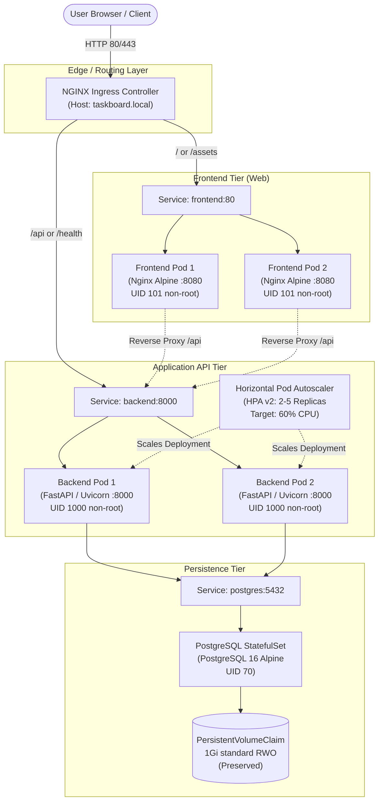
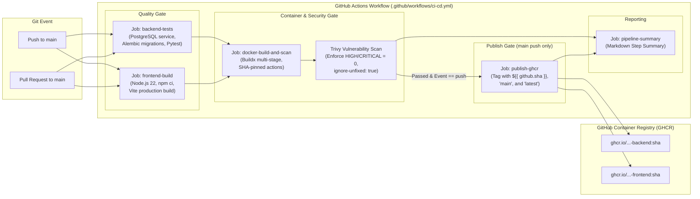
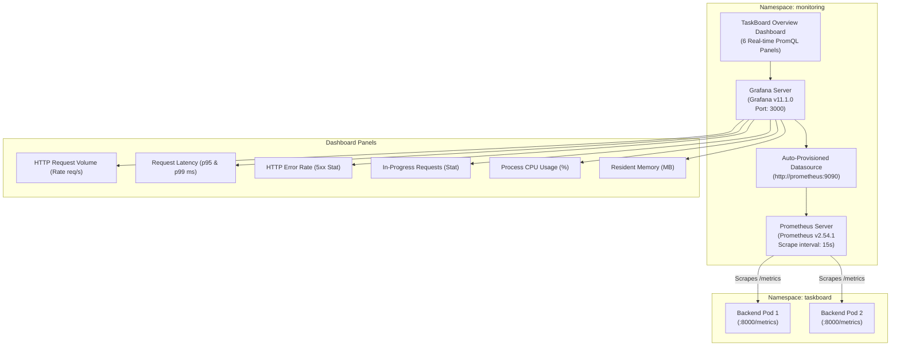
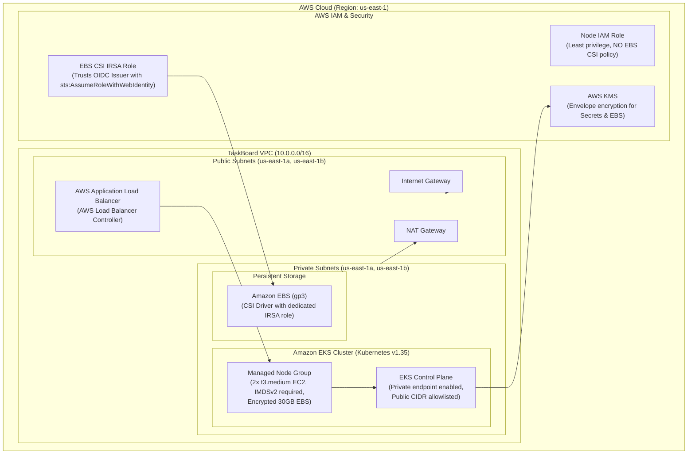

# TaskBoard DevOps Capstone — System Architecture

This document details the architectural design, network topology, container specifications, Kubernetes deployment model, CI/CD pipeline, and observability infrastructure of the TaskBoard platform.

---

## 1. High-Level Application Architecture

---

## 2. DevSecOps CI/CD Pipeline Architecture

---

## 3. Observability Architecture (Prometheus & Grafana)

---

## 4. Terraform AWS EKS Target Architecture (Configured & Statically Validated)

> [!NOTE]
> This architecture is fully defined in [`terraform/`](file:///c:/Users/Shivansh/Desktop/devops_project/terraform) and validated via `terraform validate`, but **intentionally not deployed** due to user budget constraints.

