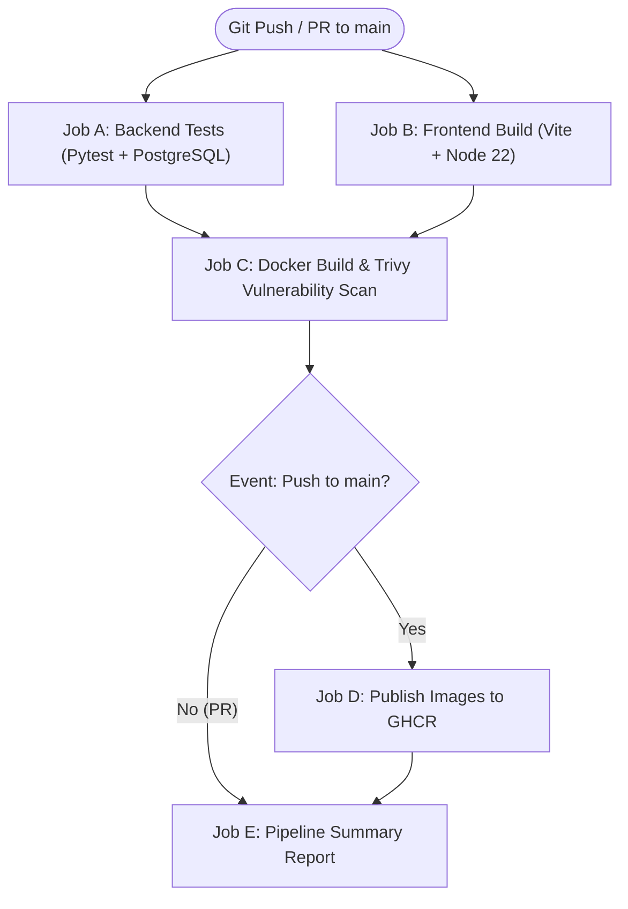

# TaskBoard DevOps Capstone — Day 3: CI/CD Pipeline, Trivy Security Scanning & GHCR

---

## 1. What CI/CD Means in TaskBoard

**Continuous Integration (CI)** is the automated practice of validating code changes as soon as they are pushed or submitted in a pull request. In TaskBoard, CI ensures:
- The backend API code passes all automated unit and integration tests against a real PostgreSQL database.
- Database migrations execute cleanly via Alembic.
- The frontend React application compiles into a production bundle without syntax or type errors.
- Container images for both frontend and backend build reliably without broken build layers.
- Both container images are deeply scanned for Known Vulnerabilities and Exposures (CVEs) before any deployment can occur.

**Continuous Delivery (CD)** is the automated practice of preparing verified software artifacts for deployment. In TaskBoard, CD automatically publishes verified, tamper-evident container images to **GitHub Container Registry (GHCR)** tagged with immutable commit SHAs and `latest` tags whenever changes land on the default `main` branch.

---

## 2. CI/CD Architecture & Job Dependency Graph

The TaskBoard pipeline (`.github/workflows/ci-cd.yml`) uses a structured, multi-stage DAG (Directed Acyclic Graph):



### Job Responsibilities

| Job Name | Identifier | Purpose | Runner & Environment |
| :--- | :--- | :--- | :--- |
| **Backend Tests** | `backend-tests` | Runs Pytest suite against real PostgreSQL 16 container with Alembic migrations | `ubuntu-latest`, Python 3.13, PostgreSQL service |
| **Frontend Build** | `frontend-build` | Clean reproducible install via `npm ci` and production bundle generation | `ubuntu-latest`, Node.js 22 |
| **Docker Build & Scan** | `docker-build-and-scan` | Builds images locally and scans OS & libraries for HIGH/CRITICAL CVEs with Trivy | `ubuntu-latest`, Docker Buildx, Trivy Action |
| **Publish to GHCR** | `publish-ghcr` | Authenticates to GHCR and pushes multi-tagged container images | `ubuntu-latest`, `GITHUB_TOKEN` (`packages: write`) |
| **Pipeline Summary** | `pipeline-summary` | Aggregates all job statuses into a rich Markdown table in `$GITHUB_STEP_SUMMARY` | `ubuntu-latest` |

---

## 3. Workflow Trigger Conditions

The workflow is configured with minimal and targeted trigger conditions:

```yaml
on:
  push:
    branches:
      - main
  pull_request:
    branches:
      - main
  workflow_dispatch: # Allows manual trigger from GitHub Web UI
```

- **Pushes to `main`**: Runs the entire pipeline (Jobs A through E), including publishing verified images to GHCR.
- **Pull Requests targeting `main`**: Runs validation and security scanning (Jobs A, B, C, and E). Job D (`publish-ghcr`) is **automatically skipped** to prevent unmerged code from contaminating the container registry.
- **Concurrency Control**: Automatically cancels outdated pull-request runs when new commits are pushed to the same branch.

---

## 4. Security & Principle of Least Privilege

### Minimal Permissions
Instead of granting broad write permissions globally, the workflow enforces global read-only access:

```yaml
permissions:
  contents: read
```

Only the `publish-ghcr` job explicitly elevates permissions to push container images:

```yaml
jobs:
  publish-ghcr:
    permissions:
      contents: read
      packages: write
```

### GITHUB_TOKEN vs Personal Access Tokens (PAT)
- The workflow utilizes GitHub's built-in `${{ secrets.GITHUB_TOKEN }}`.
- No long-lived personal access tokens or static secrets are created or stored.
- The `GITHUB_TOKEN` is automatically created per-run, scoped strictly to the current repository, and expires when the workflow finishes.

---

## 5. Trivy Container Vulnerability Scanning

### How Trivy Evaluates Images
[Aqua Security Trivy](https://github.com/aquasecurity/trivy) is an industry-standard open-source security scanner. In our pipeline:
1. Docker Buildx builds the backend (`python:3.13-slim`) and frontend (`nginx:alpine`) images.
2. Trivy scans:
   - **OS packages**: Debian / Alpine system packages installed in the base layers.
   - **Application libraries**: Python packages from `requirements.txt` and Node packages from `package-lock.json`.
3. Trivy checks against the National Vulnerability Database (NVD) and distribution security advisories.

### Blocking Policy
The scan is configured with strict blocking rules:
```yaml
severity: 'HIGH,CRITICAL'
exit-code: '1'
```
- If any vulnerability of **HIGH** or **CRITICAL** severity is detected, Trivy exits with code `1`.
- Job C immediately fails.
- Because Job D (`publish-ghcr`) declares `needs: [docker-build-and-scan]`, image publication is **completely blocked**.
- Compromised or vulnerable container images never reach the registry or production.

---

## 6. GitHub Container Registry (GHCR) Publishing

### Image Naming Convention
Image names strictly conform to the Open Container Initiative (OCI) and GHCR standards (lowercase only):
- Backend: `ghcr.io/<owner>/<repository>-backend`
- Frontend: `ghcr.io/<owner>/<repository>-frontend`

The workflow automatically converts `${{ github.repository_owner }}` and `${{ github.event.repository.name }}` to lowercase via bash `tr '[:upper:]' '[:lower:]'`, preventing casing issues.

### Tagging Strategy
Every published build receives multiple semantic tags:
1. **Immutable Commit Tag**: `:${{ github.sha }}` (e.g., `:e918362a...`) — Guarantees precise traceability back to the exact Git commit that produced the build.
2. **Latest Tag**: `:latest` — Points to the most recent successful build from the default branch.
3. **Branch Tag**: `:main` — Useful for environment deployments targeting the main branch.

---

## 7. How to Inspect Pipeline Runs & Published Images

### Viewing Workflow Runs
1. Navigate to your repository on GitHub: `https://github.com/<your-username>/taskboard-devops-capstone`.
2. Click the **Actions** tab at the top.
3. Select any workflow run to view the interactive job graph, step logs, and the **Job Summary** report.

### Viewing Published Packages on GitHub
Once a workflow on `main` completes successfully:
1. On your repository page, look at the right-hand sidebar under **Packages**.
2. You will see both:
   - `taskboard-devops-capstone-backend`
   - `taskboard-devops-capstone-frontend`
3. Click on either package to see all published versions, tags, digest SHAs, and pull instructions (e.g. `docker pull ghcr.io/<owner>/taskboard-devops-capstone-backend:latest`).

---

## 8. Required GitHub Repository Settings (Manual Step)

By default, GitHub repositories may restrict `GITHUB_TOKEN` from writing packages. If your first workflow run reports `403 Forbidden` during `docker login` or `docker push`:

1. In your GitHub repository, navigate to **Settings** → **Actions** → **General**.
2. Scroll down to **Workflow permissions**.
3. Select **"Read and write permissions"**.
4. Check **"Allow GitHub Actions to create and approve pull requests"** if applicable.
5. Click **Save**.

### Making Packages Public (Optional)
By default, packages published to GHCR from private or public repositories inherit visibility. If you wish to allow external Kubernetes clusters (in Day 5) to pull without credentials:
1. Go to your GitHub profile → **Packages**.
2. Select the published package → **Package settings**.
3. Scroll down to **Danger Zone** → **Change package visibility** → Set to **Public**.

---

## 9. Reproducing Pipeline Steps Locally (PowerShell)

You can reproduce all CI checks locally on your Windows machine before pushing:

### 1. Run Backend Pytest Suite
```powershell
& "backend\.venv\Scripts\pytest.exe" -v backend\tests
```

### 2. Run Frontend Production Build
```powershell
cd frontend
npm run build
cd ..
```

### 3. Build Docker Images Locally
```powershell
# Build backend image
docker build -t taskboard-backend:local ./backend

# Build frontend image
docker build -t taskboard-frontend:local ./frontend
```

---

## 10. Troubleshooting Common CI/CD Errors

| Error in Workflow Log | Root Cause | Solution |
| :--- | :--- | :--- |
| `permission denied` or `403 Forbidden` on GHCR login/push | `GITHUB_TOKEN` lacks package write permissions in repository settings. | Go to Repo **Settings** → **Actions** → **General** → Set **Workflow permissions** to "Read and write permissions". |
| `Trivy found HIGH or CRITICAL vulnerabilities` | A package in the base image or dependencies has an unresolved CVE. | Review the Trivy table in the log. Upgrade the affected package in `requirements.txt` or `package.json`, or bump base image. |
| `Alembic migration failed in backend-tests` | Database connection or schema conflict. | Check that the `DATABASE_URL` matches the service container credentials (`taskboard_ci:taskboard_ci_password@localhost:5432/taskboard_test`). |
| `npm ci fails with lockfile error` | `package-lock.json` is out of sync with `package.json`. | Run `npm install` locally and commit the updated `package-lock.json`. |

---

## 11. What Remains for Days 4–6

- **Day 4: Cloud Infrastructure with Terraform**: Provision AWS VPC, subnets, and AWS EKS Kubernetes cluster.
- **Day 5: Kubernetes & Helm Deployment**: Deploy our published GHCR images to EKS using Helm charts, Ingress, and Horizontal Pod Autoscalers (HPA).
- **Day 6: Observability & SRE Runbooks**: Monitor the cluster using Prometheus and Grafana dashboards.
