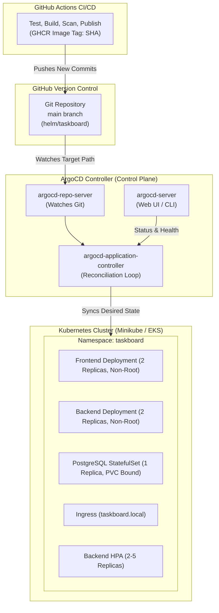

# TaskBoard GitOps with ArgoCD

This directory contains the GitOps deployment specifications and operational procedures for continuous reconciliation of the TaskBoard application via **ArgoCD**.

---

## 1. GitOps Architecture



---

## 2. Safety Constraints and PVC Preservation

To prevent data loss in stateful production environments:
1. **`prune: false`**: Automated resource deletion is explicitly disabled on the Application resource. If an upstream chart template changes, the PersistentVolumeClaim (`taskboard-postgres-pvc`) will **never** be automatically purged or disconnected by the GitOps sync controller.
2. **`selfHeal: true`**: Any manual drift (e.g. an engineer manually editing a ReplicaSet or Deployment in the cluster) is automatically reverted to match the authoritative version in Git.
3. **Secret Decoupling**: Database credentials and secrets are managed via `existingSecret: taskboard-secrets`, ensuring sensitive tokens are never committed to version control.

---

## 3. Installation & Setup Procedure

### Step 1: Install ArgoCD (When Cluster Capacity Permits)
```bash
# Create the ArgoCD namespace
kubectl create namespace argocd

# Install ArgoCD components
kubectl apply -n argocd -f https://raw.githubusercontent.com/argoproj/argo-cd/v2.12.3/manifests/install.yaml

# Wait for core controllers to be ready
kubectl wait --for=condition=available deployment/argocd-server -n argocd --timeout=300s
```

### Step 2: Access the ArgoCD Web UI
```bash
# Forward the ArgoCD server port
kubectl port-forward svc/argocd-server -n argocd 8080:443

# Retrieve the initial admin password
kubectl -n argocd get secret argocd-initial-admin-secret -o jsonpath="{.data.password}" | base64 -d
```
Open your browser to `https://localhost:8080` (login as `admin`).

### Step 3: Deploy the TaskBoard Application
```bash
kubectl apply -f k8s/argocd/application.yaml
```

### Step 4: Verify Application Synchronization
```bash
# Check status using kubectl
kubectl get application taskboard -n argocd -o yaml

# Or using the ArgoCD CLI
argocd app get taskboard
argocd app sync taskboard
```

---

## 4. Verification Checklist

| Check | Expected Result |
| :--- | :--- |
| **Sync Status** | `Synced` (Commit SHA matches latest Git commit) |
| **Health Status** | `Healthy` (All Deployments, Services, and Ingress report Healthy) |
| **Target Namespace** | `taskboard` |
| **Automated Drift Detection** | Drift detected if live cluster config changes; automatically healed |
| **Data Safety** | `taskboard-postgres-pvc` remains untouched across updates |
